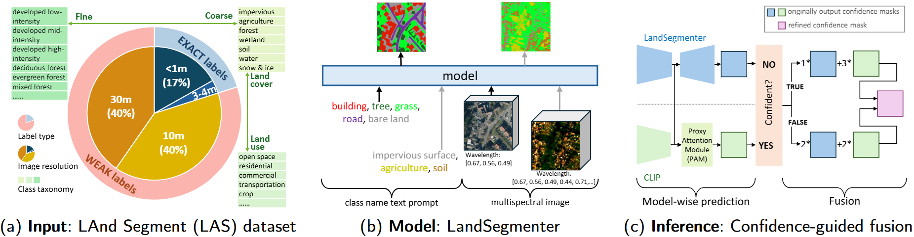
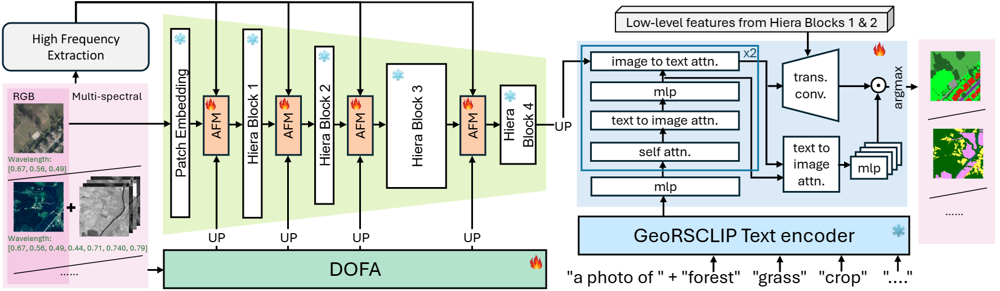
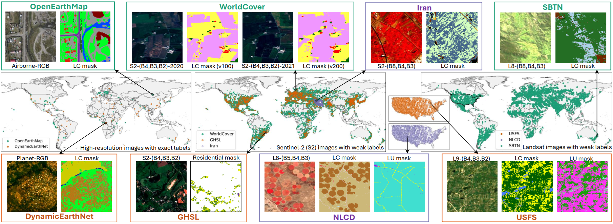

<div align="center">

<h1>LandSegmenter: Towards a Flexible Foundation Model for Land Use and Land Cover Mapping</h1>

<div>
    <strong>This repository contains the official implementation of the paper "LandSegmenter: Towards a Flexible Foundation Model for Land Use and Land Cover Mapping".
    <!-- "[Towards a Unified Copernicus Foundation Model for Earth Vision](https://arxiv.org/abs/)"</strong> -->
</div>

<div>
    Chenying Liu<sup>1,2</sup>&emsp;
    Wei Huang<sup>1</sup>&emsp;
    Xiao Xiang Zhu<sup>1,2</sup>&emsp;
</div>
<div>
    <sup>1</sup>Technical University of Munich (TUM)&emsp;
    <sup>2</sup>Munich Center for Machine Learning (MCML)&emsp;
</div>

<div>
    <h4 align="center">
    <!-- • <a href="" target='_blank'>[TGRS]</a>  -->
    <!-- • <a href="https://ieeexplore.ieee.org/document/10930953" target='_blank'> [ISPRS] </a> -->
    • [arXiv]
    <!-- • <a href="https://arxiv.org/abs/2405.01217" target='_blank'>[arXiv]</a> -->
    • <a href="https://github.com/zhu-xlab/LandSegmenter" target='_blank'>[Project]</a>
    </h4>
</div>

</div>

<div align="center">

We propose LandSegmenter, an LULC FM framework that resolves three-
stage challenges at the input, model, and output levels.

</div>

# Key features
- 👽​​ **LandSegmenter**: A task-specific Foundation Model (FM) for Land Use and Land Cover (LULC) mapping, characterized by high flexibility in both inputs (multi-band, multi-resolution imagery) and outputs (customizable category definitions), supporting both zero-shot inference and fine-tuning.
- 🕹️​ **Confidence-guided Fusion**: A class-wise confidence-guided fusion strategy that boosts LandSegmenter’s zero-shot inference through dynamic integration of CLIP's knowledge to reduce semantic omissions.
- 🗺️​ **LAS**: A large-scale weakly supervised dataset for LandSegmenter training, with ~150K globally sampled points from diverse satellite sensors and LULC products, spanning from high-resolution RGB to low-resolution multispectral imagery.


# LandSegmenter
LandSegmenter is the first LULC FM trained with LAS, designed with high flexibility to handle diverse input modalities and customizable category settings. It builds on [SAM2](https://github.com/facebookresearch/sam2)'s backbone for robust multi-scale spatial representation, further enhanced by multispectral features from [DOFA](https://github.com/zhu-xlab/DOFA) and high-frequency components for refined structural details. A text-based prompter derived from [GeoRSCLIP](https://github.com/om-ai-lab/RS5M), which takes class names as inputs, further strengthens its semantic understanding, enabling concept-aware and adaptable segmentation across heterogeneous data sources.

<div align="center">

Fig. 1. Architecture of LandSegmenter, where the attention-based fusion module (AFM) is depicted per block to indicate the consistent additional input at every stage. The embeddings sent to the decoder are the summation of the outputs from Blocks 4(upsampled) and 3. For simplicity, we omit this operator in the figure.
</div>
<br>

### 📦​ Model weights
You can download the model weights from [HuggingFace](https://huggingface.co/vikki23/LandSegmenter)

### 📥 Installation
First clone the repo:
```bash
    git clone https://github.com/zhu-xlab/LandSegmenter && cd LandSegmenter
```
We provide two installation options: with or without Docker.
- With docker (recommended):
```bash
    sh launch_docker.sh /path/to/data
    docker exec -it $USER-landseg-1 bash  
    # please replace your username at $USER, and the last number is $cid set in launch_docker.sh
    conda activate sam2
```
- Without docker:
```bash
    conda env create -f environment.yml
    conda activate sam2
    pip install -e . --no-build-isolation
```

### 🎰 Getting started
Download the checkpoints
```bash
    cd checkpoints
    sh download_ckpts.sh
    cd ..
```
Prepare the data: 
- All the data can be downloaded from [HuggingFace-LAS](https://huggingface.co/datasets/vikki23/LAS). For details, see [LAnd Segment (LAS) dataset](#land-segment-las-dataset) and [Test datasets](#test-datasets).
- For test purposes, you can prepare only the `test` data.
- Please structure your data as follows:
```bash
data # geotiff
├── exact # accurately labeled training part
│   ├── openearthmap_train.lmdb
│   ├── dynamicearthnet_seasonal.lmdb
├── weak  # weakly labeled training part
|   ├── worldcover_v100.lmdb
|   ├── worldcover_v200.lmdb
|   ├── ...
├── ft_train # fine-tuning training sets
|   ├── dw_train_lmdb
│   ├── multisenge_train.lmdb
│   ├── ...
├── test # test sets
|   ├── dw_test_lmdb
│   ├── multisenge_test.lmdb
```
Change the data path in `dataset/datasets_settings.py` at Line 3: `data_dir=...`


### ​🔮​​ Zero-shot Inference with LandSegmenter
Test on the full set and calculate accuracy:
```bash
    sh test_OV.sh $CUDA_ID $DATASET
    # Set your $CUDA_ID for export CUDA_VISIBLE_DEVICES=$CUDA_ID
    # $DATASET: potsdam / loveda / nyc / dw / osm / multisenge
```
We also provide a demo for playing around without data downloading (demo data are at `demo_data/image`):
```bash
    CUDA_VISIBLE_DEVICES=0 python ProxyCLIP/demo.py --demo_dataset multisenge
    # demo_dataset can be set to: potsdam / loveda / nyc / dw / osm / multisenge
```
Notice that the batch size would affect the final outputs of ProxyCLIP models and the fusion results, since ProxyCLIP applies the batch-wise adaptive normalization and masking approach to the similarity matrix. A larger batch size would perform more robust than `batch_size=1`. The results in our paper were generated with `batch_size=20`.


### 👻​ LandSegmenter Training 
```bash
    sh train_landsegmenter.sh
```
Notice that the script automatically detects and uses all the GPUs available. Please set your own CUDA_VISIBLE_DEVICES, or remove the CUDA_VISIBLE_DEVICES if you use slurm with `sbath`. 


### ☄️​ LandSegmenter Fine-tuning
```bash
    sh train_fine_tune.sh $CUDA_ID $DATASET
```

# LAnd Segment (LAS) dataset

We curate the LAnd Segment (LAS) dataset, which builds upon existing LULC products as weak supervision to tackle the scarcity of medium-to-low resolution annotations for model training. The dataset is sampled from regional grids covering diverse land surface types, with an exact-to-weak label ratio of 1:4. LAS also incorporates a larger number of region-level classes, enriching the semantic representation of Earth surface structures. 

<div align="center">

Fig. 2: LAS dataset for LandSegmenter training. Middle: geographic distributions of each subset. From left to right, read the distributions of high-resolution, Sentinel-2 (S2), and Landsat-8/9 (L8/9) subsets. Top and Bottom: examples from each subset.
</div>
<br>

### 🗒️ Core properties:
Designed to bridge gaps between natural image processing and LULC mapping, LAS addresses:
- integration of multispectral RS data beyond RGB;
- adaptation to medium-to-low-resolution RS imagery;
- domain knowledge of land surface properties.

As a result, LAS includes ∼150k globally distributed sample points (∼311k image patches and ∼200k label masks) across eight subsets (see Tab. 1):
1) high-resolution RGB subset from OpenEarthMap (GSD: 0.25–0.5m, patch size: 320);
2) RGB-NIR subset from DynamicEarthNet (GSD: 3–4m; patch size: 256);
3) three Sentinel-2 (S2) subsets (GSD: 10m; 12–13 bands; patch size: 264);
4) three Landsat-8/9 (L8/9) subsets (GSD: 30m; 7–11 bands; patch size: 264).

### ​📥​ Download
#### Raw data:
- Six weakly labeled subsets can be downloaded from [HuggingFace](https://huggingface.co/datasets/vikki23/LAS/tree/main/train_weak_raw)
- Two accurately labeled subsets are publicly available: [OpenEarthMap](https://open-earth-map.org/) & [DynamicEarthNet](https://mediatum.ub.tum.de/1650201)

The scripts used for downloading the weakly labeled data can be found under `data_preparation`.
#### LMDB:
We also provide our processed data (in `lmdb` format) on HuggingFace: [weak](https://huggingface.co/datasets/vikki23/LAS/tree/main/train_weak_lmdb) & [Exact](https://huggingface.co/datasets/vikki23/LAS/tree/main/train_exact_lmdb).

# Test datasets
We utilized 6 accurately labeled LULC datasets which are publicly available for evaluation:
- [Potsdam](https://www.isprs.org/education/benchmarks/UrbanSemLab/)
- [LoveDA](https://github.com/Junjue-Wang/LoveDA)
- [NYC](https://data.cityofnewyork.us/Environment/Land-Cover-Raster-Data-2017-6in-Resolution/he6d-2qns/about_data)
- [DW](https://huggingface.co/datasets/vikki23/NoLDO-S12)
- [OSM](https://huggingface.co/datasets/vikki23/NoLDO-S12)
- [MultiSenGe](https://multisenge.github.io/)

For reproducibility, we also provide our processed data in `lmdb` format on HuggingFace:
- [test data](https://huggingface.co/datasets/vikki23/LAS/tree/main/test_lmdb)
- [fine-tuning data](https://huggingface.co/datasets/vikki23/LAS/tree/main/fine_tune_train_lmdb)


# Acknowledgements
This repository builds upon [SAM2](https://github.com/facebookresearch/sam2), [SAM-Adapter](https://github.com/tianrun-chen/SAM-Adapter-PyTorch), [ProxyCLIP](https://github.com/mc-lan/ProxyCLIP), and [CromSS](https://github.com/zhu-xlab/CromSS). We sincerely thank the authors for their contributions to the open-source community. All usage of these resources is subject to their original licenses.

# Citation
```BibTeX
@ARTICLE{liu-cromss,
  author={Liu, Chenying and Huang, Wei and Zhu, Xiao Xiang},
  journal={}, 
  title={LandSegmenter: Towards a Flexible Foundation Model for Land Use and Land Cover Mapping}, 
  year={2025},
  volume={},
  number={},
  pages={in press}}
```